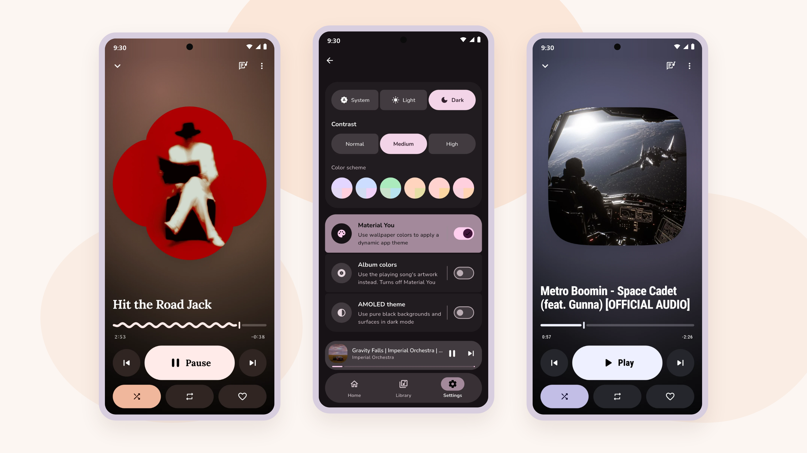
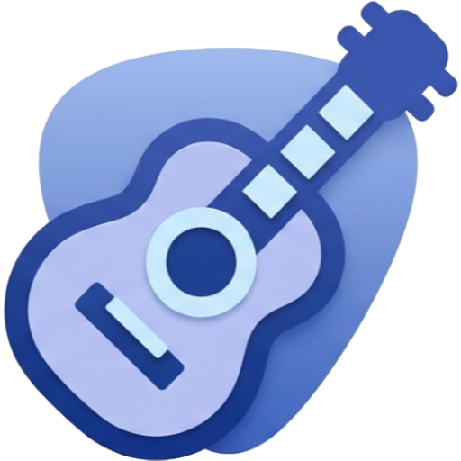

<p align="center">
  
</p>

<p align="center">
  
</p>

<h1 align="center">Snap</h1>

<p align="center">
  <b>A local music player that wears your album art.</b><br>
  Built with Flutter and Material 3 Expressive. Shapes that morph, colours that follow the music, and everything stays on your phone.
</p>

<p align="center">
  <a href="https://github.com/herosafi2009-beep/Snap/releases/latest"></a>
  
  
</p>

<p align="center">
  
  
  
  
  
  
</p>

<p align="center">
  <a href="#-features">Features</a> ·
  <a href="#-the-expressive-bits">The expressive bits</a> ·
  <a href="#-roadmap">Roadmap</a> ·
  <a href="#-build-it-yourself">Build it</a> ·
  <a href="#-credits">Credits</a>
</p>

---

## ✨ Features

| | |
|---|---|
| 🎨 **Colours from your music** | The whole app re-tints itself from the playing song's artwork, or follows your wallpaper with Material You. Pick from presets, set contrast, or go full AMOLED black. |
| 🌸 **Shape-shifting artwork** | Show covers as a clover, cookie, arch, squircle, circle or rounded card. The shapes morph smoothly instead of snapping. |
| 〰️ **Wavy progress bar** | The seek bar ripples while music plays and settles flat when paused. |
| 📚 **A real library** | Songs, albums, artists, genres and folders, with 9 sort options and filter chips. Rescans only read new or changed files. |
| 🎤 **Synced lyrics** | Time-synced (LRC) lyrics that follow the song, read from your files or looked up online. |
| 🔀 **Gapless playback** | Gapless queue, shuffle, repeat one/all, background play, lock screen and notification controls, and it pauses when your headphones disconnect. |
| 📝 **Playlists, done properly** | Drag to reorder, custom or auto-generated collage artwork, plus **10 smart playlists** that update themselves. |
| 🏠 **A home screen that knows you** | Quick picks, continue listening, "Made for you", recently added and most played. Reorder or hide any section. |
| 📊 **Listening stats** | Daily, weekly and monthly listening time, when you listen most, and your top songs, artists and albums. |
| 🔍 **Search everything** | Songs, albums, artists, playlists and genres, with accent-insensitive matching. |
| 🎧 **Spatial audio status** | Shows what Android actually reports about spatial audio and head tracking, with no fake claims. |
| 📱 **Adaptive layouts** | Bottom navigation on phones, a navigation rail in landscape, and a sidebar, player bar and queue panel on tablets. |
| 🔒 **Private by default** | No account, no tracking, no ads. Your library, history and stats never leave your device. |

---

## 🌸 The expressive bits

Snap leans fully into **Material 3 Expressive**, Google's newest, boldest version of Material Design:

- **Custom shapes:** the clover and cookie artwork outlines are drawn as morphable shapes (`widgets/expressive_shapes.dart`), and the squircle is a true superellipse, the same kind of curve Pixel icons use.
- **Motion with personality:** springy buttons, artwork that shrinks when paused, a slowly drifting background, and swipe gestures to skip or close.
- **Bold type and big controls:** a pill-shaped Play/Pause button, large serif track titles, and five optional open-source fonts (Lexend, Nunito, Outfit, Lora, Roboto Condensed).

---

## 🗺️ Roadmap

- [ ] 📈 **Real-time audio visualiser** (FFT frequency bars in the app's colours)
- [ ] 🎚️ **Equaliser** with bass, mid and treble controls
- [ ] 🎤 **Karaoke mode** that removes vocals with phase cancellation
- [ ] 🤖 **AI stem separation:** split songs into vocals, drums and bass
- [ ] 🏪 Google Play release

---

## 📥 Download

Grab the latest APK from **[Releases](https://github.com/herosafi2009-beep/Snap/releases/latest)**.

> On modern phones, use `app-arm64-v8a-release.apk` if it's listed. Android may ask you to allow **"Install unknown apps"** for your browser or file manager, and Play Protect may show a warning because the app isn't from the Play Store. Tap **Install anyway**.

---

## 🛠️ Build it yourself

<details>
<summary><b>Requirements and commands</b> (click to expand)</summary>

<br>

**You'll need:** Flutter 3.47+ (Dart 3.13), the Android SDK (platform 36) and JDK 17 or 21.

```bash
flutter pub get
flutter run                     # with a phone (USB debugging) or emulator
flutter test
```

**Release APK:**

```bash
flutter build apk --release --split-per-abi
```

The APKs end up in `build/app/outputs/flutter-apk/`.

**After changing the database schema** (`lib/data/database/app_database.dart`):

```bash
dart run build_runner build
```

**Regenerating launcher icons:**

```bash
dart run tool/make_icons.dart
dart run flutter_launcher_icons
```

</details>

<details>
<summary><b>Project structure</b></summary>

<br>

```
lib/
  core/       theme (Material 3 + album colour extraction), routing, layout, services
  data/       Drift database + migrations, models, repositories
  features/   home, library, player, queue, lyrics, playlists, search, statistics, settings
  widgets/    shared UI: artwork shapes, expressive shapes, track tiles, player buttons
test/         unit, database and widget tests
tool/         icon generator
```

</details>

<details>
<summary><b>Built with</b></summary>

<br>

| Area | Packages |
|---|---|
| State & navigation | `flutter_riverpod`, `go_router` |
| Audio | `just_audio`, `just_audio_background`, `audio_session` |
| Database | `drift` (SQLite) |
| Library & files | `audio_metadata_reader`, `file_picker`, `permission_handler` |
| Theming | `dynamic_color`, `material_color_utilities` |

</details>

---

## 💜 Credits

- Designed around Google's **Material 3 Expressive** guidelines.
- Fonts: Lexend, Nunito, Outfit, Lora and Roboto Condensed from [Google Fonts](https://github.com/google/fonts), under the SIL Open Font License (licences included in `assets/fonts`).
- Built by **Safi Ur Rehman**, developed with the help of **Claude** (AI).

## 📄 License

Released under the **MIT License**. See [LICENSE](LICENSE).

---

<p align="center">
  <i>Made with 🎧 and Flutter in Lahore, Pakistan.</i><br>
  <sub>If you like Snap, leave a ⭐. It really helps!</sub>
</p>
